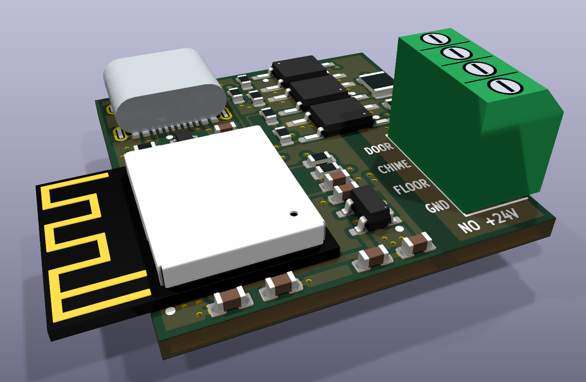
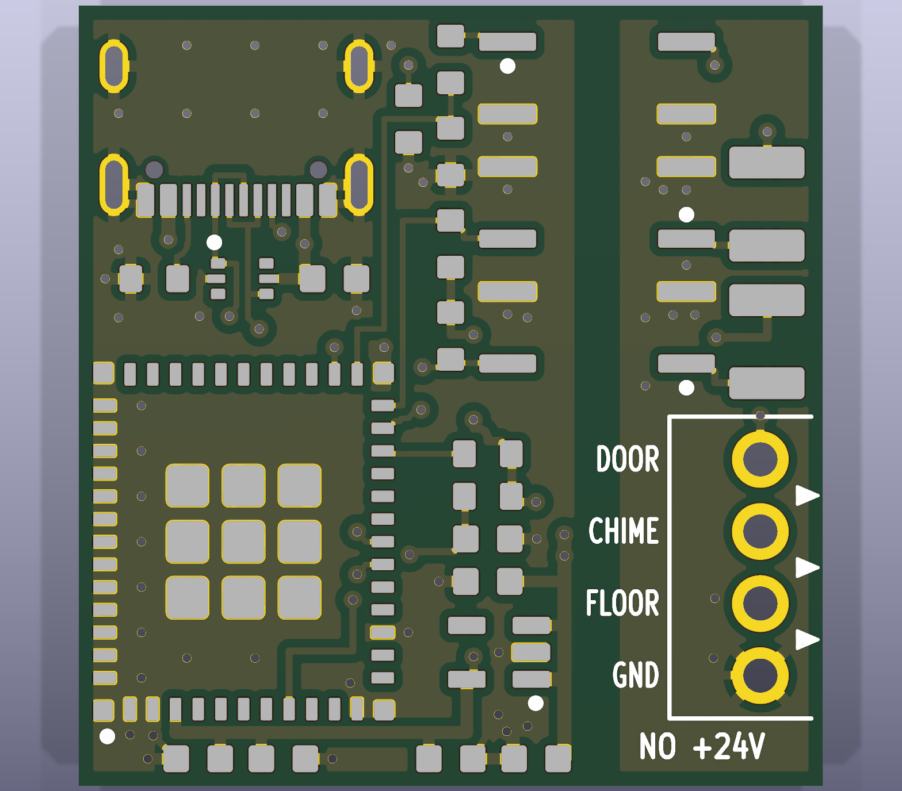
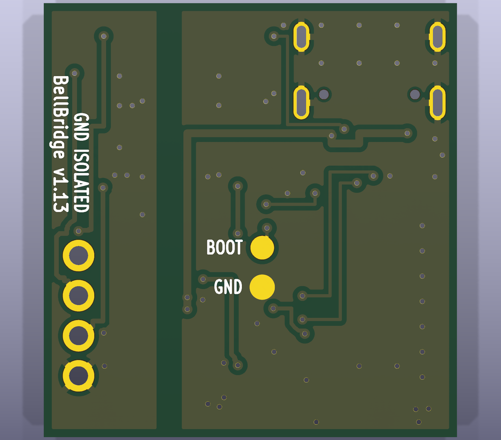

# BellBridge

**An isolated ESP32-C6 board that brings a Ritto 7630 TwinBus apartment intercom into Home Assistant.**

BellBridge connects to four terminals of the indoor station. It tells the
**apartment bell** from the **street bell** and can **open the street door**, all
locally through [ESPHome](https://esphome.io/) with no cloud involved. It is the circuit of
[duramson/ritto-esp](https://github.com/duramson/ritto-esp) turned into a
26.2 × 27.5 mm board that PCBWay assembles completely, ESP32-C6 module included.

<!-- TODO after testing: replace the status line, e.g.
> **Status:** v1.13 built and tested on a Ritto 7630 (YYYY-MM-DD), see the [test report](docs/testing.md).
-->
> [!WARNING]
> **Status:** hardware v1.13 is designed and checked, but it has not yet been built or
> tested on an intercom. It is v1.1, the smaller follow-up of v1.0, with three part values
> changed (v1.12) and the bus ground routed with tracks (v1.13); see the
> [changelog](CHANGELOG.md).

<!-- TODO: add photos, e.g.


-->



The assembled board as a KiCad render: USB-C at the top edge, the module on the left
with its antenna sticking out 5.2 mm past the edge, the screw terminal on the right edge.
The USB-C receptacle and the screw terminal are simplified models drawn to their
datasheet dimensions; the other parts use the 3D models from KiCad's and Espressif's
libraries.

| Top (render) | Bottom (render) |
| --- | --- |
|  |  |

These two renders show the bare board, pads and silkscreen without the parts.

## Features

- **Two bells told apart:** the chime line pulses on every ring, and the floor line drops
  only on an apartment ring. The firmware combines the two into "Doorbell Main" and
  "Doorbell Apartment".
- **Door opener:** an "Open Door" button in Home Assistant pulls the opener line to bus
  ground for 0.5 s (adjustable). An optional "Auto Open" switch lets every street ring
  open the door while it is on, for expected guests; it turns itself off after an
  adjustable time (30 minutes by default) and on every restart.
- **Galvanic isolation:** all three lines go through optocouplers. Bus ground and USB
  ground are kept apart by a 1.6 mm copper-free strip on both layers.
- **Powered from USB-C (5 V), not from the bus.** USB ESD protection right in the D+/D−
  path, 3.3 V LDO.
- **ESP32-C6-MINI-1-N4:** Wi-Fi 6 with a PCB antenna, an encrypted Home Assistant API and
  OTA updates, and diagnostics (signal, uptime, chip temperature, IP address).
- **Fully assembled by PCBWay.** The screw terminal is the only through-hole part.
- **Drop-in for ritto-esp:** same terminal order, same ESPHome node and entity names,
  so existing automations keep working.

## How it works

The Ritto 7630 shares one two-wire TwinBus with both door stations and all flats.
[ritto-esp](https://github.com/duramson/ritto-esp#reverse-engineering-the-bus) measured the
board with an oscilloscope:

| Ritto terminal | Signal | Behaviour |
| --- | --- | --- |
| 2 KLINGEL (chime) | input | about 5 V for ~500 ms on **any** ring |
| 4 ETAGE (floor) | input | idles at about 5 V, **drops to ground** while the apartment button is pressed |
| 5 door opener | output | buzzes the street door when **pulled to ground** |
| 1 / 6 GND | ground | bus ground |
| 3 +24 V | — | bus supply, **never connected to BellBridge** |

A falling ETAGE line means "apartment bell". The chime pulse that follows about 1.6 s later
is blocked for a few seconds, so a chime pulse on its own means "street door".

## Hardware at a glance

| | |
| --- | --- |
| Size | 26.2 × 27.5 mm, 2 layers, 1.6 mm, no mounting holes; 31.4 × 27.5 mm with the module's antenna, which sticks out past the left edge |
| Tallest part | screw terminal J1, 8.4 mm; then the USB-C receptacle, 3.3 mm, and the module, 2.4 mm |
| Controller | Espressif ESP32-C6-MINI-1-N4 (4 MB flash, PCB antenna) |
| Power | USB-C, 5 V; AP2112K-3.3 LDO; USBLC6-2P6 ESD protection |
| Inputs | CHIME and FLOOR, 1.5 kΩ / 0.5 W into LTV-357T optocouplers (about 2.5 mA at 5 V) |
| Output | DOOR, LTV-357T transistor to bus ground |
| Isolation | separate grounds, 1.6 mm copper-free barrier, optocoupler pad rows 4.3 mm apart, 3,750 V<sub>rms</sub> optocouplers |
| Terminal | DORABO DB125-2.54, 4 pins at 2.54 mm: DOOR, CHIME, FLOOR, GND |

Details, the parts list and the design checks are in [hardware/README.md](hardware/README.md).

## Versions

| | v1.13 (current), [v1.12](https://github.com/JayChickenK/bellbridge/tree/v1.12) and [v1.1](https://github.com/JayChickenK/bellbridge/tree/v1.1) | [v1.0](https://github.com/JayChickenK/bellbridge/tree/v1.0) |
| --- | --- | --- |
| Board | 26.2 × 27.5 mm; 31.4 mm wide with the antenna | 36.4 × 31.5 mm |
| Antenna | past the left edge, as Espressif recommends | on the board, at its edge |
| USB-C | top edge, HRO's recommended land | left edge, KiCad's land |
| USB ESD array | USBLC6-2P6 in the D+/D− path | USBLC6-2SC6 on side branches |
| Optocouplers | LTV-357T (SO-4) | LTV-817S (SMDIP-4) with a milled slot |
| Passives | 0603; R2/R3 in 1210, 0.5 W | 0805; R2/R3 in 2512, 1 W |
| Terminal | DORABO, 2.54 mm, 26–18 AWG | KANGNEX, 3.81 mm, 26–16 AWG |
| Download mode, reset | test pads on the back, replug USB | BOOT and RESET buttons |

v1.12 is v1.1 with three part values changed (R6 10 kΩ, C6 10 µF, C2 22 µF) and a wider
panel note for PCBWay; the copper is the same. v1.13 adds tracks for the bus ground, so it no
longer depends on the ground pour alone. All versions have the same circuit,
terminal order and GPIOs, and none has been built yet. The firmware in this branch runs on
all of them; the copy in the v1.0 files has a bell-logic bug (see the
[changelog](CHANGELOG.md)). Each version's order files are attached to its
[release](https://github.com/JayChickenK/bellbridge/releases).

## Wiring

| BellBridge J1 | Ritto 7630 terminal |
| --- | --- |
| DOOR | 5 (door opener) |
| CHIME | 2 (KLINGEL) |
| FLOOR | 4 (ETAGE) |
| GND | 1 or 6 (GND) |
| — | 3 (+24 V) stays unconnected |

See [docs/installation.md](docs/installation.md) before you open the intercom.

## Getting started

1. **Order** the assembled board: [docs/ordering.md](docs/ordering.md).
2. **Flash** the firmware over USB-C: [firmware/README.md](firmware/README.md).
3. **Test** it on the bench: [docs/testing.md](docs/testing.md).
4. **Install** it at the intercom: [docs/installation.md](docs/installation.md).
5. **Automate** in Home Assistant. The
   [ritto-esp automations](https://github.com/duramson/ritto-esp/tree/main/home-assistant)
   (notifications, parcel mode, personal door webhooks) work unchanged.

## Test results

<!-- TODO after testing: fill in from docs/testing.md -->

| Test | Result |
| --- | --- |
| Assembly inspection, isolation, 3.3 V rail | not yet tested |
| Flashing over USB-C, Wi-Fi signal | not yet tested |
| Bench test of CHIME, FLOOR and DOOR | not yet tested |
| Street bell, apartment bell, door opener on a Ritto 7630 | not yet tested |
| Long-term run without false triggers | not yet tested |

## Repository layout

```
hardware/    board generator (generate.py), KiCad board, BOM, CPL, PCBWay order files
firmware/    ESPHome configuration and secrets template
docs/        ordering, installation and test guides, images
```

## Credits

- [duramson/ritto-esp](https://github.com/duramson/ritto-esp): reverse engineering of the
  7630, the circuit and the ESPHome firmware this board is built on (MIT License).
- [deh0511.de TwinBus](https://deh0511.de/twinbus/) and
  [quhfan.de](https://quhfan.de/post/ritto-twinbus-7630-smart-home-assistant/): terminal
  pinout of the 7630.

## License

[MIT](LICENSE). The firmware is derived from ritto-esp, whose MIT notice is kept in
[LICENSE](LICENSE) and in the firmware file.

Ritto and TwinBus are trademarks of their respective owners. This project is not
affiliated with or endorsed by them. You build and install it at your own risk. In a rented
flat, the intercom usually belongs to the building, so ask before you modify it.
