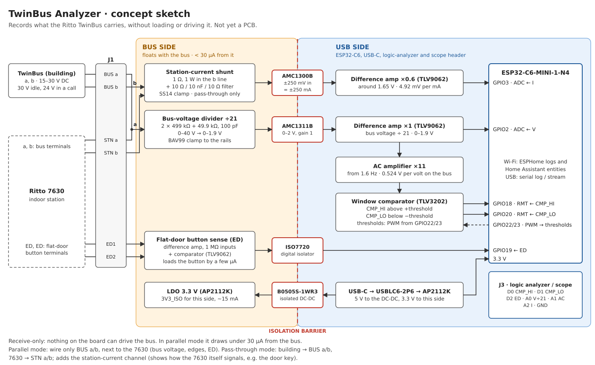

# TwinBus Analyzer (concept)

> [!NOTE]
> **Status:** concept sketch. There is no PCB yet, and nothing has been built or measured.

A receive-only board that records what the Ritto TwinBus carries on its two wires, so the
signalling can be worked out. That is the first step towards a BellBridge that connects
only to a/b, the way Ring Intercom and Nuki Opener do. No public description of the
TwinBus signalling exists, so this board records everything without assuming a format:
the bus voltage, the indoor station's current, every edge of the bus signal, and the
flat-door button.

## Ground rules

- **Receive-only.** No part on the board can drive the bus. In parallel mode it draws
  under 30 µA from the bus (the 1.05 MΩ divider at 30 V).
- **Isolated from the PC.** The bus side gets its power through an isolated DC-DC
  converter and talks to the ESP32 only through isolation amplifiers and a digital
  isolator. A laptop, logic analyzer or oscilloscope on the USB side never touches the
  bus. The bus is a safety extra-low voltage; the isolation keeps ground loops off the
  building's bus.
- **Ask first.** The bus is shared by every flat. In a rented flat, ask the owner before
  you connect anything to it.

## What is known about the bus

- Ritto's TwinBus power supply 1757301 delivers DC 30–15 V at up to 0.5 A. A Ritto service
  brochure lists DC 30 V on an idle bus and DC 24 V during a door call.
- The door opener hangs on the power supply (5–8 V, 1 A), so "open the door" must travel
  over the bus as a command.
- Speech and data share the same two wires.
- Unknown: which wire is plus, how data is modulated, the bit timing, and how flats are
  addressed. Finding that out is the job of this board.

## Connections

| Mode | Wiring | Channels |
| --- | --- | --- |
| Parallel (start here) | BUS a/b to the 7630's a/b terminals, next to the station's own wires | bus voltage, edges, flat-door button |
| Pass-through | building cable to BUS a/b, the 7630 to STN a/b | adds the station's current |

ED1/ED2 are optional and go to the 7630's ED terminals, in parallel with the flat-door
button. Pass-through mode shows how the 7630 itself signals, for example when you press
its door key.

## Channels

| Channel | Front end | Range | To the ESP32 and J3 |
| --- | --- | --- | --- |
| Bus voltage | 2 × 499 kΩ + 49.9 kΩ (÷21), AMC1311B, difference amp ×1 | 0–40 V → 0–1.9 V | GPIO2 (ADC), A0 |
| Station current | 1 Ω shunt in b, 10 Ω / 10 nF / 10 Ω, AMC1300B (×8.2), difference amp ×0.6 around 1.65 V | ±250 mA, 4.92 mV per mA | GPIO3 (ADC), A2 |
| Bus signal (AC) | from the voltage channel, high-pass at 1.6 Hz, ×11 | 0.524 V per volt of change, around 1.65 V | A1 |
| Edges | window comparator TLV3202 on the AC signal, thresholds set by PWM | ±0.05–2.5 V on the bus, adjustable | GPIO18 and GPIO20 (RMT), D0 and D1 |
| Flat-door button | difference amp with 1 MΩ inputs and comparator, ISO7720 | about 1 V and up between ED1 and ED2 | GPIO19, D2 |

## Bus side

- **J1:** a 6-pole screw terminal at 2.54 mm (DORABO DB125-2.54-6P, the family of
  BellBridge's J1): BUS a, BUS b, STN a, STN b, ED1, ED2. Intercom wire of 0.6–0.8 mm fits.
- **a** runs straight from BUS a to STN a. **b** runs through the shunt (1 Ω, 1 W, 2512).
  Two SS14 diodes in anti-parallel across it limit the voltage if the station side is
  shorted. The shunt drops at most 0.1 V at 100 mA.
- **Divider:** two 499 kΩ resistors in series (1206), so one shorted resistor still leaves
  499 kΩ, then 49.9 kΩ to b and 100 pF. The BAV99 clamp sits behind the high-value
  resistors, so the bus never sees its capacitance. There is no TVS diode across a/b.
- **Supply:** B0505S-1WR3 (1 W, 5 V to 5 V, isolated) and an AP2112K-3.3 make 3V3_ISO for
  this side (about 15 mA). The bus-side ground is the b wire.

## USB side

- The proven blocks from BellBridge: HRO TYPE-C-31-M-12, USBLC6-2P6, AP2112K-3.3 and an
  ESP32-C6-MINI-1-N4 with its antenna past the board edge.
- Three TLV9062 dual op-amps: the two difference amplifiers, the AC amplifier, a 1.65 V
  reference, and on the bus side the ED stage.
- The window comparator gets its thresholds from two PWM outputs (GPIO22 and GPIO23)
  through 10 kΩ / 1 µF filters, so the firmware sets them.
- **J3** (2 × 5 pins, 2.54 mm): D0 CMP_HI, D1 CMP_LO, D2 ED, D3 spare, A0 bus voltage ÷21,
  A1 AC signal, A2 station current, 3.3 V and two GND. A cheap 24 MHz USB logic analyzer
  with PulseView records the edges for hours; an oscilloscope shows the shapes. Both sit
  on the USB side.

| ESP32-C6 pin | Use |
| --- | --- |
| GPIO2 | ADC: bus voltage ÷21 |
| GPIO3 | ADC: station current |
| GPIO18 | CMP_HI, RMT receive |
| GPIO20 | CMP_LO, RMT receive |
| GPIO19 | flat-door button |
| GPIO22, GPIO23 | PWM for the two comparator thresholds |

## Firmware

1. **Ready to use:** [`firmware/twinbus-analyzer.yaml`](firmware/twinbus-analyzer.yaml)
   (ESPHome, checked with 2026.9.1). It logs every pulse train from the two comparators
   with the length of each pulse and gap in microseconds ("Received Raw: ..."), the bus
   voltage and the station current once a second, and the flat-door button. The edge
   threshold is a setting in Home Assistant. Copy
   [`../../firmware/secrets.yaml.example`](../../firmware/secrets.yaml.example) to
   `secrets.yaml` next to the YAML file, then run `esphome run twinbus-analyzer.yaml` and
   `esphome logs twinbus-analyzer.yaml`.
2. **Later:** a capture firmware that samples the ADC continuously (about 80 kSps), keeps a
   few milliseconds before each edge, and streams every event over USB or Wi-Fi to a PC
   script that writes PulseView or CSV files.

## Measurement plan

Note the time of every action, so each burst in the log can be matched to it.

1. With a multimeter: the voltage between a and b while idle and during a call, and which
   wire is plus.
2. Idle for a few hours: does the bus carry anything without calls (polling, keep-alive)?
3. A call from the street door to your flat. Let it ring out once, and answer once.
4. A call to a neighbour's flat (ask them first). The difference to step 3 shows the
   address.
5. The 7630's door key, during a call and without one.
6. Lift the handset and speak: how the speech sits on the bus.
7. The flat-door button: does anything appear on the bus at all?
8. Any other keys the 7630 has, such as a light key.

Repeat each step three to five times. The parts that stay the same are the command; the
parts that differ between flats are the address.

## Parts (rough)

| Ref | Part | Note |
| --- | --- | --- |
| U1 | TI AMC1311B | isolated amplifier, 0–2 V input, bus voltage |
| U2 | TI AMC1300B | isolated amplifier, ±250 mV input, station current |
| U3 | TI ISO7720 | dual digital isolator, flat-door button and a spare |
| U4 | Mornsun B0505S-1WR3 | isolated DC-DC, 1 W |
| U5, U7 | Diodes AP2112K-3.3 | 3.3 V for each side |
| U6 | ST USBLC6-2P6 | USB ESD protection |
| U8 | Espressif ESP32-C6-MINI-1-N4 | as on BellBridge |
| U9–U11 | TI TLV9062 | dual op-amps |
| U12 | TI TLV3202 | dual comparator, push-pull |
| J1 | DORABO DB125-2.54-6P | bus, station and ED wires |
| J2 | HRO TYPE-C-31-M-12 | USB-C |
| J3 | 2 × 5 pin header, 2.54 mm | logic analyzer and oscilloscope |
| R_SH | 1 Ω, 1 W, 2512 | station-current shunt |

The parts come to roughly 20–25 € per board; the two isolation amplifiers are about half
of that. The board would be about 60 × 40 mm with two layers, generated the same way as
BellBridge.

## Open before a PCB

- Measure the bus polarity and the real voltage range with a multimeter.
- Measure the voltage on the ED terminals with the 7630 connected.
- Decide whether unattended long recordings need an SD card, or whether Wi-Fi logging is
  enough.

## Sources

- [Ritto TwinBus power supply 1757301, technical data (retailer page)](https://hardy-schmitz.de/Ritto%201757301%20Netzger%C3%A4t%20%20TWINBUS-3673230.html)
- [Ritto power supply service brochure, 2011](https://merten.de/fileadmin/import/files/ritto/brochure/Ritto_Netzgeraet_Erste_Hilfe_2011.pdf)
- [duramson/ritto-esp](https://github.com/duramson/ritto-esp): the 7630's board signals and
  why its author avoided powering from the bus
